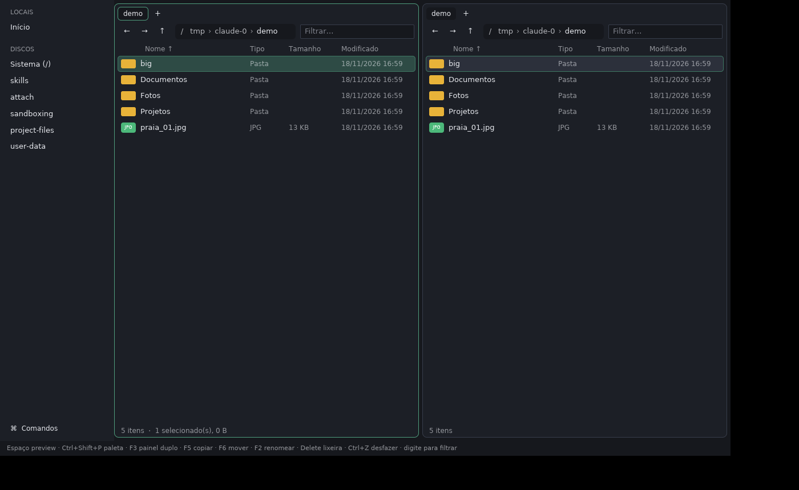
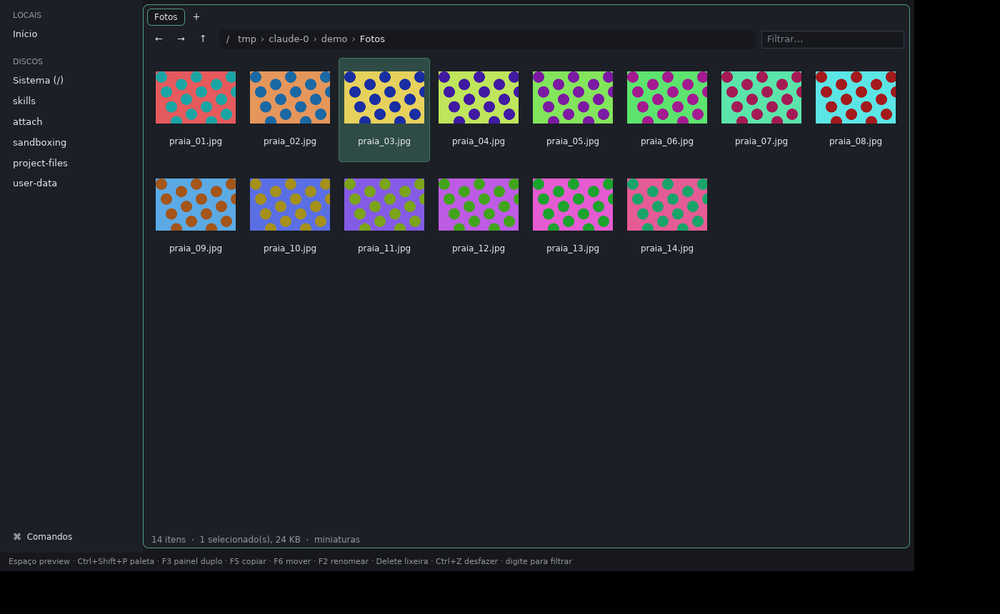

# arbor

Explorer de arquivos rápido, open source e multiplataforma (Linux, macOS e Windows), escrito em Rust com [iced](https://iced.rs).

A regra principal: **a interface nunca espera pelo disco.** A listagem roda numa thread própria e chega em lotes (a pasta aparece na hora, mesmo com 50 mil arquivos), a lista é virtualizada (só as linhas visíveis viram widgets) e cópias, miniaturas e preview rodam em segundo plano.



## O que já faz

- **Abertura instantânea**: primeiro lote de 256 itens sai antes do resto da pasta ser lido.
- **Painel duplo e abas** (F3, Ctrl+T, Ctrl+W, Ctrl+Tab), com histórico por aba (Alt+← / Alt+→).
- **Busca fuzzy**: é só digitar com a lista em foco. Usa o `nucleo` (a engine do Helix).
- **Paleta de comandos** (Ctrl+Shift+P ou Ctrl+K) com todos os comandos e atalhos.
- **Preview com Espaço**: imagens (todos os formatos do Vislo, com EXIF), texto e código, resumo de pastas. As setas trocam o arquivo com o preview aberto.
- **Miniaturas** (Ctrl+G) geradas e cacheadas em disco pelo `vislo-core`.
- **Cópia confiável**: grava em `.nome.arbor-part`, confere o tamanho e só então renomeia. Cancelar nunca deixa arquivo pela metade. Conflitos viram `nome (2).ext`.
- **Desfazer** (Ctrl+Z) para copiar, mover, renomear, nova pasta e lixeira (restaurar da lixeira funciona no Windows e Linux; no macOS ainda não).
- Teclas no estilo Total Commander: F2 renomear, F5 copiar e F6 mover para o outro painel, F7 nova pasta, F8/Delete lixeira.
- Ctrl+C / Ctrl+X / Ctrl+V entre pastas, arrastar arquivos de outro app para dentro da janela, atualização automática quando a pasta muda no disco.
- Duplo clique numa imagem abre o **Vislo**, se estiver instalado (procura no `PATH`, nos locais padrão de cada sistema ou em `ARBOR_VISLO`); senão, o app padrão do sistema.
- Tema escuro e claro, arquivos ocultos (Ctrl+H), ordenação por nome, tamanho, data e tipo (Ctrl+1..4).

| Miniaturas | Preview |
|---|---|
|  |  |

## Rodar

```sh
cargo run --release            # abre na pasta pessoal
cargo run --release -- ~/Fotos # ou numa pasta específica
```

No Linux, o sistema precisa das bibliotecas de janela de sempre (`libxkbcommon-x11`, Vulkan ou OpenGL).

## Atalhos

| Tecla | Ação |
|---|---|
| Enter / duplo clique | Abrir |
| Shift+Enter | Abrir com o app do sistema |
| Espaço | Preview |
| Backspace, ← | Pasta acima |
| digitar | Filtrar a pasta (Esc limpa) |
| Ctrl+Shift+P, Ctrl+K | Paleta de comandos |
| Ctrl+L (ou duplo clique no caminho) | Ir para caminho (aceita `~`) |
| F3 / Tab | Painel duplo / trocar de painel |
| F5 / F6 | Copiar / mover para o outro painel |
| F2 / F7 / Delete | Renomear / nova pasta / lixeira |
| Ctrl+Z | Desfazer |
| Ctrl+G / Ctrl+H | Miniaturas / ocultos |
| Ctrl+Shift+C | Copiar caminho |
| Ctrl+' | Terminal nesta pasta |

No macOS, Ctrl vira ⌘.

## Estrutura

| Arquivo | Papel |
|---|---|
| `src/model.rs` | Entradas, listagem em lotes numa thread, ordenação natural |
| `src/ops.rs` | Copiar, mover, lixeira, renomear, nova pasta e desfazer, com progresso e cancelamento |
| `src/app.rs` | Estado e `update` (navegação, seleção, atalhos, tarefas) |
| `src/view.rs` | Interface: lista virtualizada, grade de miniaturas, paleta, preview |
| `src/media.rs` | Preview e miniaturas via `vislo-core` |
| `src/launch.rs` | Abrir arquivos, achar o Vislo, terminal |
| `src/watch.rs` | Atualização automática (`notify`) |
| `src/fuzzy.rs` | Busca fuzzy (`nucleo-matcher`) |
| `src/commands.rs` | Catálogo de comandos e atalhos |

## Fora do escopo por enquanto

De propósito, para não repetir o Spacedrive: nada de nuvem, sincronização ou indexação global. Próximos passos naturais: arrastar entre painéis, menu de contexto, navegar dentro de .zip, busca recursiva e indexação opcional (MFT no Windows).
