<div align="center">

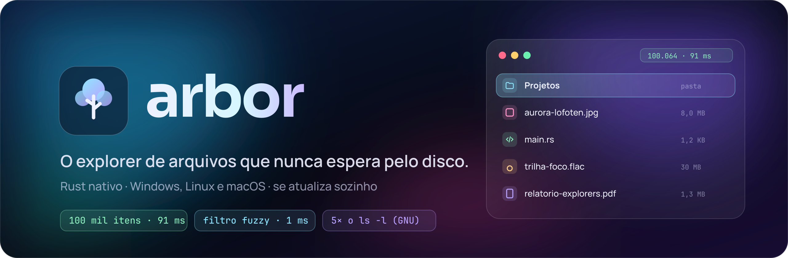

<br/>

[](https://github.com/juninmd/arbor/releases/latest)
[](https://github.com/juninmd/arbor/actions/workflows/ci.yml)
[](https://github.com/juninmd/arbor/actions/workflows/bench.yml)
[](https://github.com/juninmd/arbor/releases)
<br/>
[](https://www.rust-lang.org)
[](https://iced.rs)
[](#instalação)
[](LICENSE)

<br/>

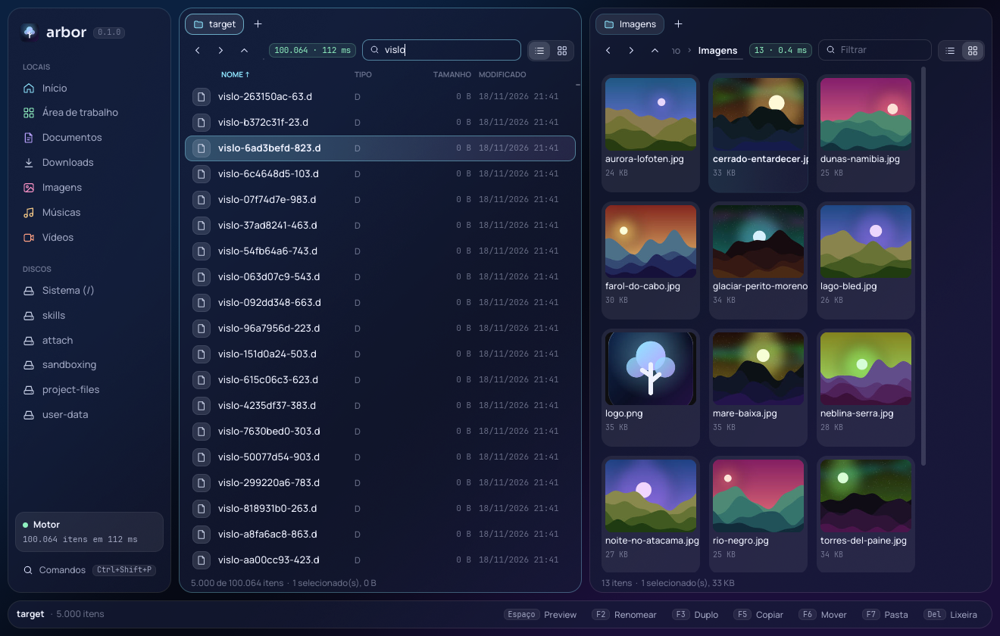

</div>

> **Abra uma pasta com 100 mil arquivos e ela já está na tela.** O primeiro quadro sai em menos de 1 ms, a pasta inteira
> chega ordenada em ~90 ms e o filtro fuzzy responde em ~1 ms por tecla. O número fica na tela, em cada pasta.

---

## O que é

arbor é um explorer de arquivos nativo, escrito em Rust com [iced](https://iced.rs), para **Windows, Linux e macOS**.
Ele ataca o que mais irrita nos explorers de hoje: a barra lateral que demora 10 s, a pasta grande que congela a janela,
o F5 que não atualiza. A regra que guia tudo: **a interface nunca espera pelo disco.** Nada de I/O, decodificação ou
ordenação de lista grande roda na thread de interface.

O visual vem do protótipo *arbor Glass*: aurora ao fundo, cartões de vidro, uma cor por tipo de arquivo, a pílula de
seleção em gelo e íris e a velocidade visível ("N itens em X ms"). A janela é de vidro de verdade onde o sistema
deixa: vibrancy no macOS e transparência com desfoque do compositor no Linux; no Windows o vidro é o da aurora, e o Mica é experimental (`ARBOR_GLASS=1`)
(`ARBOR_NO_GLASS=1` desliga o vidro no macOS e no Linux). O escopo é enxuto de propósito, a lição do
Spacedrive: nada de nuvem, sincronização ou tags.

## Índice

[Funcionalidades](#funcionalidades) · [Desempenho](#desempenho) · [Instalação](#instalação) ·
[Atualização automática](#atualização-automática) · [Atalhos](#atalhos) · [Arquitetura](#arquitetura) ·
[Desenvolvimento](#desenvolvimento) · [Releases](#releases) · [Roteiro](#roteiro) · [Licença](#licença)

## Funcionalidades

* **Instantâneo.** A pasta é lida numa thread própria; os primeiros 256 itens aparecem ordenados antes do resto ser
  lido, e a lista completa chega como um snapshot imutável. A lista é virtualizada: 200 mil arquivos custam o mesmo
  que 50.
* **Bonito em movimento.** Tema *Glass* com fontes Sora, Manrope e JetBrains Mono embutidas, ícones por tipo
  (pasta, imagem, código, documento, áudio, vídeo, compactado).
* **Temas:** Aurora, Claro, Meia-noite, Grafite, Oceano, Pôr do sol e, vindos do canto-widget, Canto, Hueco Mundo, Drácula e Vidro, cada um com a própria aurora atrás do vidro.
  Escolha pelo botão de paleta na barra de título ou pela paleta de comandos ("Tema: …", "Próximo tema"); fica
  salvo em `~/.config/arbor/settings`.
* **Janela própria**, no jeito do Explorer do Windows 11: abas na barra de título, faixa com endereço e barra de
  comandos, minimizar/maximizar/fechar, arrastar e redimensionar pelas bordas (`ARBOR_NATIVE_FRAME=1` volta para
  a moldura do sistema). **Abas verticais** opcionais (menu do tema ou "Abas verticais" na paleta).
* **Velocidade visível.** Cada pasta mostra quantos itens tem e quanto custou listar e ordenar; `F12` liga um medidor
  de fps com o pior quadro do último segundo.
* **Abre em "Este Computador"**, como o Explorer: pastas do usuário e discos/volumes com barra de uso e espaço
  livre. Subir da raiz de um disco volta para lá. O que falta para a paridade está em
  [docs/inventario-explorer-windows.md](docs/inventario-explorer-windows.md).
* **Início**: Acesso rápido (pastas fixadas e as mais visitadas) e Recentes (os últimos 30 arquivos abertos
  pelo arbor, salvos na pasta de configuração do arbor).
* **Rede**: computadores da rede local (Windows pelo serviço Navegador; Linux pelo `avahi-browse`, com
  `smbclient` para listar compartilhamentos e `gio` para montá-los).
* **Barra de comandos e menu de contexto** como no Explorer (Nova pasta, recortar, copiar, colar, renomear,
  excluir, Classificar, Visualizar), com itens apagados quando não se aplicam. **Fixar pastas** na barra lateral.
* **Agrupar por** tipo, data de modificação ("Hoje", "Ontem", "Semana passada"…) ou tamanho, pelo menu Classificar
  ou pelo botão direito na área vazia: em Detalhes cada grupo ganha um cabeçalho com a contagem.
* **Mouse como no Explorer:** retângulo de seleção a partir da área vazia; arrastar itens para uma pasta, a barra
  lateral ou o outro painel (mesmo disco move, outro disco copia; `Ctrl` copia, `Shift` move).
* **Painel duplo e abas** (`F3`, `Ctrl+T`, `Ctrl+W`, `Ctrl+Tab`), com histórico por aba (`Alt+←` / `Alt+→`; botão direito em Voltar/Avançar lista o histórico). O `›` da barra de endereço lista as subpastas daquele nível e cada pasta lembra ordenação e lista/grade.
* **Colunas**: botão direito no cabeçalho mostra/oculta Tipo, Tamanho e Modificado; arraste a divisória para mudar a largura (`~/.config/arbor/columns`).
* **Tamanho das pastas** na coluna Tamanho (paleta: "Ligar/desligar tamanho das pastas"): somado em segundo plano
  depois da listagem, em paralelo, e cancelado ao trocar de pasta; ordenar por tamanho passa a considerar as pastas.
* **Abrir com…** (diálogo nativo no Windows, programa digitado no Linux/macOS) e **Ejetar** mídia removível.
* **Filtro fuzzy** em paralelo (`nucleo`, a engine do Helix): é só digitar. Cada letra a mais filtra só o resultado
  anterior.
* **Comparar e sincronizar pastas** no painel duplo, como no Total Commander: `Shift+F2` seleciona em cada lado o
  que só existe nele ou é mais novo (`F5` copia); "Sincronizar com o outro painel" copia tudo isso de uma vez,
  depois de confirmar, substituindo as versões antigas e sem apagar nada.
* **Navegação sincronizada** no painel duplo (paleta: "Navegação sincronizada"): entrar numa subpasta de um
  lado entra na de mesmo nome do outro, e subir sobe os dois, como no Directory Opus.
* **Menu da aba** (botão direito): duplicar (`Ctrl+Shift+D`), **travar** (a aba fica na pasta dela; navegar a
  partir dela abre outra aba, e ela não fecha junto), fechar as outras, à esquerda ou à direita.
* **Visão plana** (`Ctrl+B`, como no Total Commander): a aba lista todos os arquivos da pasta e das subpastas,
  com a pasta de cada um embaixo do nome; dá para ordenar, filtrar e copiar como numa pasta comum.
* **Curinga e seleção por máscara**, como no Total Commander: `*.jpg;*.png` no filtro mostra só o que casa;
  `Num +` / `Num −` somam ou tiram da seleção por máscara, `Num *` inverte, e "Selecionar todos do mesmo tipo"
  está na paleta.
* **Paleta de comandos** (`Ctrl+Shift+P`) com todos os comandos e atalhos, e **pastas frequentes** (`Ctrl+K`): digite parte do nome de uma pasta já visitada e pule para ela.
* **Preview com Espaço** de imagens (todos os formatos do [Vislo](https://github.com/juninmd/vislo), com EXIF),
  texto e código, e resumo de pastas. **Miniaturas** (`Ctrl+G`) de imagens (inclusive PSD e RAW), capa de MP3 e
  FLAC, vídeo e PDF, com cache em disco limitado a 512 MB. Vídeo e PDF usam o Quick Look no macOS e, no Linux e no
  Windows, o `ffmpeg` e o `pdftoppm` (Poppler) se estiverem no PATH; sem eles, fica o ícone do tipo.
* **Cópia confiável:** grava em `.nome.arbor-part`, confere o tamanho e só então renomeia. Cancelar nunca deixa
  arquivo pela metade. **Desfazer** (`Ctrl+Z`) para copiar, mover, renomear, nova pasta e lixeira.
* **Atualiza sozinho** a partir das releases deste repositório, com o SHA-256 conferido antes de trocar o executável.
* Teclas no estilo Total Commander, arrastar arquivos para a janela, pasta atualizada sozinha quando muda no disco,
  e duplo clique numa imagem abre o Vislo, se estiver instalado.

| Aurora | Claro, com abas verticais |
|---|---|
| 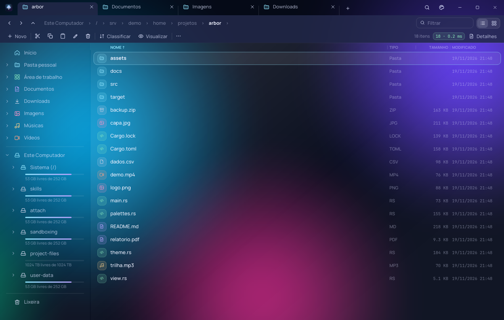 | 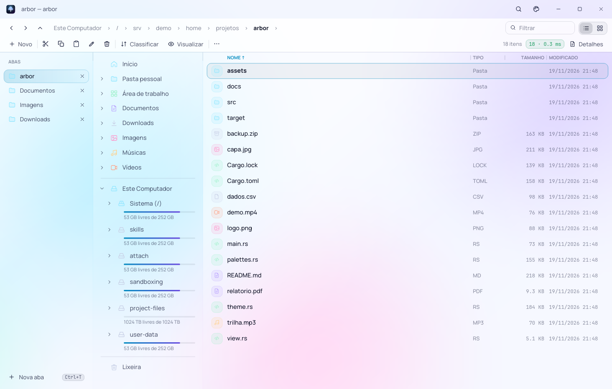 |
| 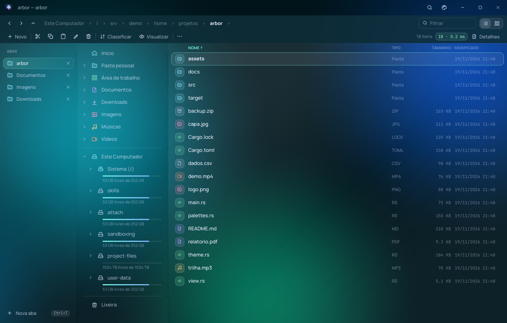 | 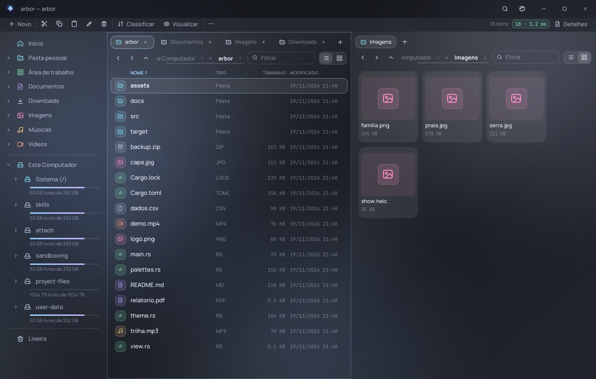 |
| 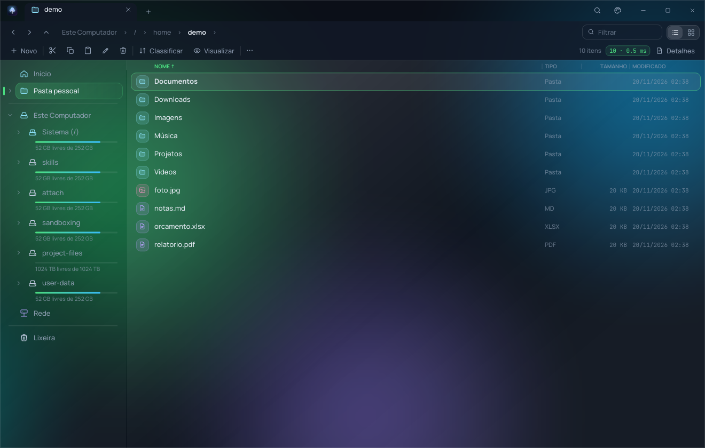 | 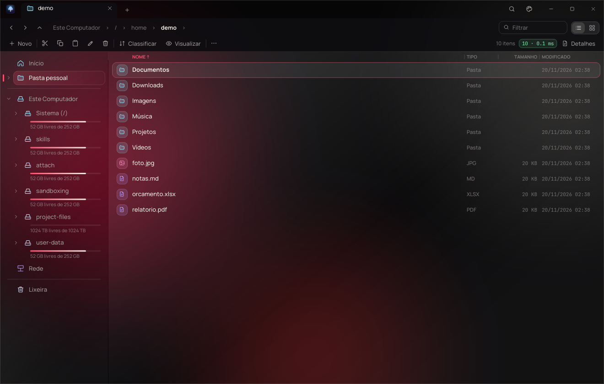 |
| 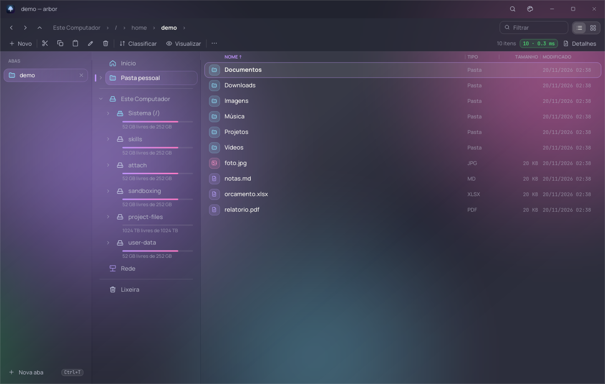 | 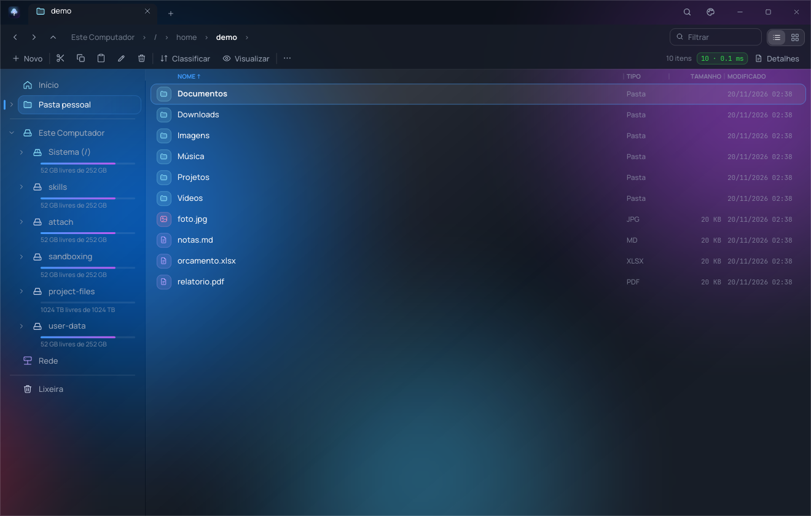 |

| Paleta de comandos | Preview com Espaço |
|---|---|
| 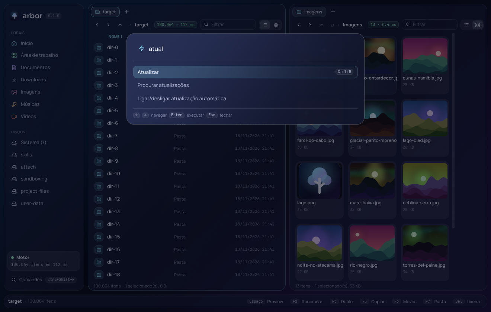 | 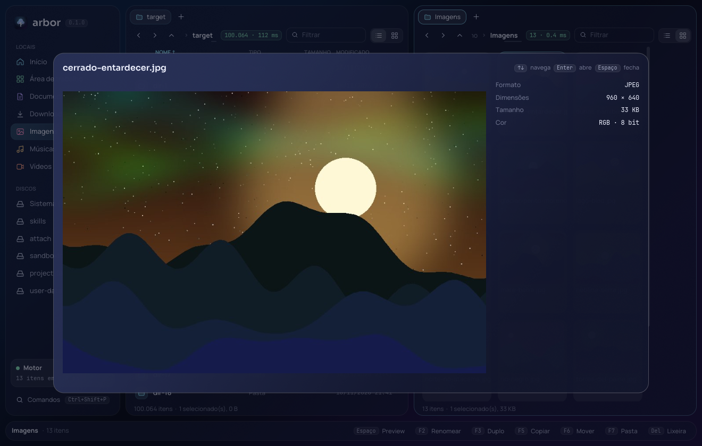 |

## Desempenho

As metas do [plano](https://claude.ai/artifact/6pz11DwuP4WwtAohDcULDT) são testes: o workflow
[`bench`](.github/workflows/bench.yml) roda o `arbor-bench suite --check` em Windows, Linux e macOS a cada PR e falha
se uma meta for estourada. Os números abaixo são de um Linux de 4 núcleos com SSD, numa pasta com 100.064 itens
gerada pelo próprio `arbor-bench gen` (nomes no estilo de uma pasta `target/` de Rust).

| Medida | arbor | Meta |
|---|---:|---:|
| Primeiro quadro (256 itens ordenados) | **0,3 ms** | < 50 ms |
| Pasta completa: listar, ler metadados e ordenar | **91 ms** | < 400 ms |
| Reordenar 100 mil itens por tamanho | **15 ms** | < 50 ms |
| Filtro fuzzy por tecla, 100 mil nomes | **1,1 ms** | < 8 ms (um quadro a 120 Hz) |

### Contra as ferramentas de sempre

Mesma pasta, mesma máquina, [hyperfine](https://github.com/sharkdp/hyperfine) com aquecimento
([`scripts/bench-compare.sh`](scripts/bench-compare.sh)). Explorers gráficos não têm modo de linha de comando, então a
comparação justa é com quem faz o mesmo trabalho: listar, ler tamanho e data de cada arquivo e ordenar.

| Listar 100 mil arquivos | Tempo | |
|:---|---:|---:|
| **arbor** (listar + stat + ordem natural) | **91 ms** | 1,0× |
| `fd` (só nomes, sem ler metadados) | 85 ms | 0,9× |
| `find -printf` tamanho e data (sem ordenar) | 185 ms | 2,0× |
| `ls -l --sort=version` (GNU) | 467 ms | 5,1× |
| `eza -l` | 780 ms | 8,6× |

| Filtrar 100 mil nomes por "vislo" | Tempo | |
|:---|---:|---:|
| **arbor** (`nucleo` em paralelo) | **12 ms** | 1,0× |
| `fzf --filter` | 24 ms | 2,1× |

O arbor lê metadados e ordena e mesmo assim empata com o `fd`, que só lê nomes. No Windows o workflow compara também
com `dir` e `Get-ChildItem`; os números de cada plataforma ficam no resumo do job
[bench](https://github.com/juninmd/arbor/actions/workflows/bench.yml).

### Por que é rápido

* **Metadados em paralelo.** Os nomes saem do disco num passe só (`getdents` / `FindNextFile`) e o `stat` de cada
  arquivo roda em todos os núcleos (`rayon`). No Windows os metadados já vêm da enumeração.
* **Ordem natural sem comparar texto.** Cada nome ganha uma chave em bytes, calculada uma vez, em que `img2` vem antes de
  `img10`; ordenar 100 mil nomes vira `memcmp` em paralelo.
* **mimalloc.** A listagem cria centenas de milhares de alocações pequenas em várias threads; com o alocador do sistema
  elas disputam o mesmo lock e a mesma pasta levava 4× mais (360 ms contra 91 ms).
* **Snapshots imutáveis.** A interface recebe um `Arc<Vec<Entry>>` pronto, nunca uma mensagem por arquivo; ao
  atualizar uma pasta aberta, a lista antiga fica na tela até a nova estar completa.
* **Gerações.** Cada listagem carrega a geração da aba; sair da pasta descarta o resultado e para a thread.

## Instalação

Baixe o arquivo da sua plataforma na [última release](https://github.com/juninmd/arbor/releases/latest):

| Sistema | Arquivo | Como abrir |
|---|---|---|
| Windows 10/11 (x64) | `arbor-<versão>-windows-x86_64.zip` | descompacte e abra `arbor.exe` (portátil) |
| macOS 11+ (Apple Silicon / Intel) | `arbor-<versão>-macos-aarch64.zip` / `-x86_64.zip` | arraste `arbor.app` para Aplicativos; na 1ª vez, botão direito → Abrir |
| Linux (x64 / arm64) | `arbor-<versão>-linux-x86_64.tar.gz` / `-aarch64.tar.gz` | descompacte e rode `./arbor`; o `.desktop` e o ícone vêm junto |

Cada release traz também os binários puros (`arbor-<versão>-<so>-<arq>`), que são o que a atualização automática
baixa, e o `SHA256SUMS.txt`. A proveniência de cada binário é assinada no CI:

```sh
gh attestation verify arbor-0.2.0-linux-x86_64 --repo juninmd/arbor
```

No Linux, o sistema precisa das bibliotecas de janela de sempre (`libxkbcommon-x11`, Vulkan ou OpenGL). Para compilar:

```sh
cargo run --release            # abre na pasta pessoal
cargo run --release -- ~/Fotos # ou numa pasta específica
```

## Atualização automática

O arbor se atualiza a partir das releases deste repositório, com a mesma abordagem do Vislo:

```
abriu + 4 s / a cada 6 h ──► GET releases/latest ──► tag mais nova? ──► aviso "arbor X disponível"
                                                                            │ Atualizar e reiniciar
   arbor novo abre ◄── troca o executável ◄── SHA-256 confere? ◄── baixa arbor-X-<so>-<arq>
```

* A verificação roda alguns segundos depois da janela abrir, então nunca atrasa a abertura. A paleta tem
  *Procurar atualizações* e *Ligar/desligar atualização automática*; `ARBOR_NO_UPDATE=1` também desliga.
* Só HTTPS e só links de `github.com/juninmd/arbor/releases/download/`; o binário é comparado com o
  `SHA256SUMS.txt` da release e descartado se não bater.
* O download mostra o progresso e pode ser cancelado. Os arquivos ficam numa pasta própria com nome imprevisível no
  cache do usuário, apagada ao fim (e as esquecidas, depois de 24 h).
* A troca usa [`self-replace`](https://crates.io/crates/self-replace), que funciona com o executável aberto também no
  Windows. Cópias em pastas sem permissão de escrita (instaladas pelo sistema) recebem o link da release em vez disso.

## Atalhos

| Tecla | Ação |
|---|---|
| `Enter` / duplo clique | Abrir |
| `Shift+Enter` | Abrir com o app do sistema |
| `Espaço` | Preview (as setas trocam o arquivo) |
| `Backspace` | Pasta acima |
| digitar | Filtrar a pasta (`Esc` limpa); com `*` ou `?` vira curinga (`*.jpg;*.png`) |
| `Num +` / `Num −` / `Num *` | Selecionar / tirar da seleção por máscara / inverter seleção |
| `Ctrl+Shift+F` / `Ctrl+Enter` no filtro | Buscar nesta pasta e em todas as subpastas (palavras ou `*.pdf`) |
| `Ctrl+B` | Visão plana: todos os arquivos das subpastas numa lista só (de novo volta) |
| `Ctrl+Shift+P` | Paleta de comandos |
| `Ctrl+K` | Pular para pasta frequente |
| `Ctrl+L`, `Alt+D`, `F4` (ou duplo clique no caminho) | Ir para caminho (aceita `~`; `Tab` completa a pasta) |
| `Ctrl+Shift+D` | Duplicar aba (botão direito na aba: travar, fechar as outras / à esquerda / à direita) |
| `Ctrl+Shift+T` | Reabrir aba fechada (a paleta tem *Restaurar abas ao abrir*) |
| `F3` / `Tab` | Painel duplo / trocar de painel |
| `Ctrl+N` | Nova janela |
| botões laterais do mouse | Voltar / avançar |
| `F5` / `F6` | Copiar / mover para o outro painel |
| `Shift+F2` | Comparar as pastas dos dois painéis (seleciona o que difere) |
| `F2` / `F7` / `Delete` | Renomear / nova pasta / lixeira |
| `Shift+Delete` | Excluir permanentemente (pede confirmação) |
| `Ctrl+Z` | Desfazer |
| `Ctrl+E` / `Ctrl+Shift+E` | Extrair compactado / compactar em zip (zip, 7z e tar abrem como pasta com `Enter`) |
| `Ctrl+G` / `Ctrl+H` | Miniaturas / ocultos |
| `Ctrl+roda`, `Ctrl+=` / `Ctrl+-` | Troca a visualização: Conteúdo ← Detalhes → Lista → Blocos → ícones pequenos, médios, grandes, extra grandes |
| `Ctrl+1` … `Ctrl+4` | Ordenar por nome, tamanho, data, tipo |
| botão direito, `Shift+F10`, tecla Menu | Menu de contexto do item ou da pasta |
| `Alt+Shift+P` / `Alt+Enter` | Painel de detalhes / propriedades |
| `F12` | Medidor de fps |
| `Ctrl+Shift+C` | Copiar caminho |
| ``Ctrl+' `` | Terminal nesta pasta |

No macOS, `Ctrl` vira `⌘`. Para trocar qualquer atalho, use *Editar atalhos* na paleta: abre o arquivo `keys` (uma linha `Tecla = Comando` por atalho) e *Recarregar atalhos* aplica sem reiniciar.

## Arquitetura

Um workspace em camadas. A regra: a interface só recebe snapshots prontos para desenhar.

```
crates/arbor-core    sem interface, testável: listagem paralela, ordem natural, filtro fuzzy, operações e desfazer
crates/arbor-bench   benchmarks reproduzíveis (gen, suite --check, list, filter)
src/                 o app iced
  app.rs             estado e update: navegação, seleção, atalhos, tarefas, atualização
  view.rs            interface: lista virtualizada, grade de miniaturas, paleta, preview, doca
  theme.rs           tokens do protótipo Glass: cores, fontes, raios, estilos e ícones
  aurora.rs          a aurora do protótipo (manchas gelo, íris, rosa e menta) pintada numa textura
  glass.rs           vidro nativo: vibrancy no macOS, transparência no Linux
  listing.rs         ponte entre a listagem do arbor-core e o iced
  update/            atualização automática (GitHub Releases + SHA-256 + self-replace)
  media.rs           preview via vislo-core
  thumbs/            miniaturas: imagens (vislo-core), capa de áudio, vídeo e PDF (ffmpeg, pdftoppm, Quick Look)
  watch.rs           pasta atualizada sozinha (notify)
  launch.rs          abrir arquivos, achar o Vislo, terminal
  commands.rs        catálogo de comandos e atalhos
```

Decisões tomadas a partir do plano: **ficar no iced** (o GPUI só entra se a meta de 120 fps falhar), **as três
plataformas no mesmo ritmo** e **índice global desligado por padrão** quando ele chegar.

## Desenvolvimento

A versão do Rust está fixada em [`rust-toolchain.toml`](rust-toolchain.toml): o `rustup` instala a mesma no CI e
na sua máquina, e um lint novo do Clippy só chega quando ela sobe num commit próprio.

```sh
cargo test --workspace                                  # núcleo, app e updater
cargo clippy --workspace --all-targets -- -D warnings
cargo deny check                                        # vulnerabilidades, licenças e origens (deny.toml)
node --test scripts/*.test.mjs                          # planejador de versão
cargo run --release -p arbor-bench -- suite /tmp/bench-100k --check
scripts/bench-compare.sh /tmp/bench-100k                # contra ls, eza, find, fd, fzf
```

## Releases

Todo push em `main` vira uma release, sem passos manuais ([`release.yml`](.github/workflows/release.yml)):

1. O CI roda (fmt, clippy, cargo-deny, testes nas três plataformas).
2. A próxima versão sai dos [commits semânticos](https://www.conventionalcommits.org) desde a maior tag `vX.Y.Z`
   (`feat` → minor, `fix` e demais → patch, `!` → major).
3. Windows x64, Linux x64 e arm64, macOS Apple Silicon e Intel são construídos e empacotados; o `SHA256SUMS.txt` é
   escrito e a proveniência é assinada.
4. `chore(release): vX.Y.Z` é commitado e tagueado, e a release sai com notas agrupadas por tipo.
5. As cópias abertas veem a release e oferecem *Atualizar e reiniciar*.

## Roteiro

| Fase | Entrega | Estado |
|---|---|---|
| 0. Base | workspace, `arbor-core`, benchmark de 100 mil arquivos no CI, tema do protótipo | ✅ |
| 1. Velocidade | listagem paralela, ordem natural por bytes, filtro paralelo e incremental, mimalloc | ✅ |
| 2. Beleza | tema Glass, fontes, ícones por tipo, selo de ms e medidor de fps; vidro nativo no macOS e Linux; Mica no Windows e animações com mola | 🟡 |
| 3. Poder | fila de operações com pausa, desfazer persistente, navegar em .zip/.7z/.tar, instância única | ⬜ |
| 4. Busca global | índice opcional (MFT/USN no Windows, varredura + observador nos outros) | ⬜ |

## Licença

[MIT](LICENSE). As fontes em `assets/fonts` (Sora, Manrope, JetBrains Mono) são distribuídas sob a
[SIL Open Font License](assets/fonts/OFL.txt).
